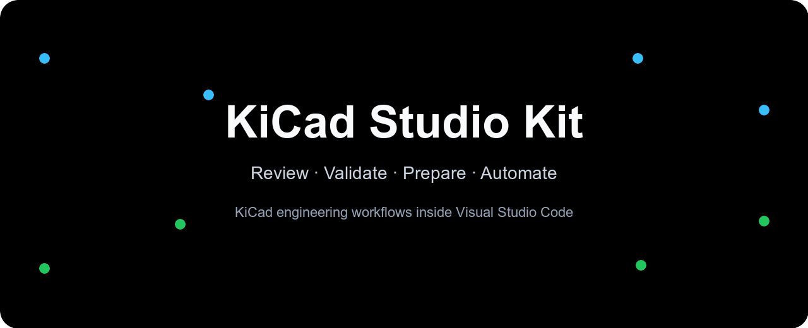
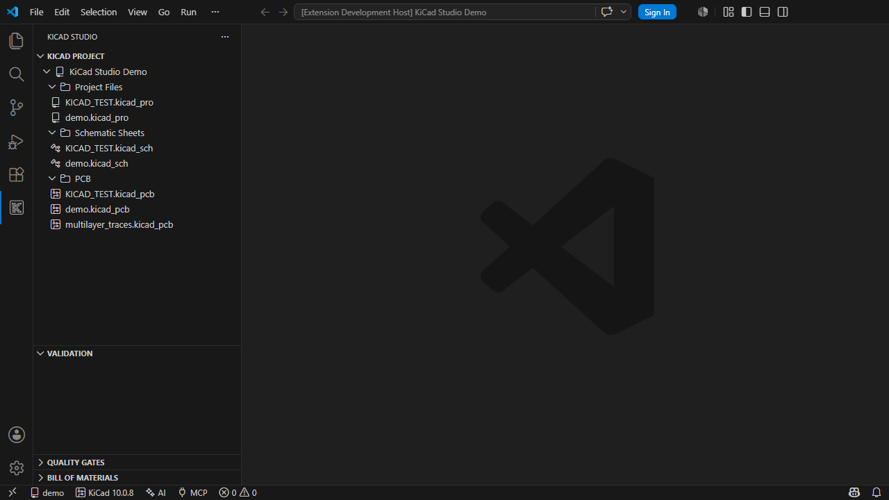
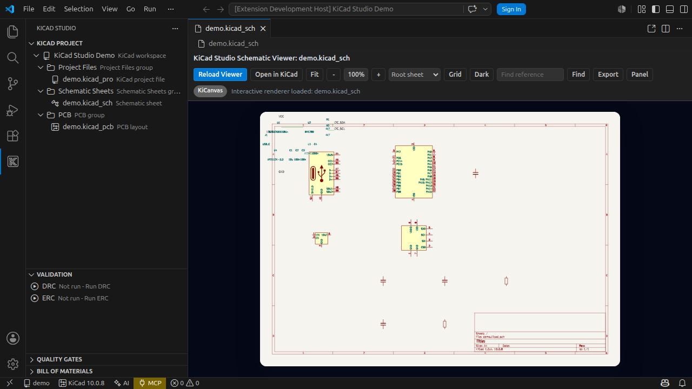
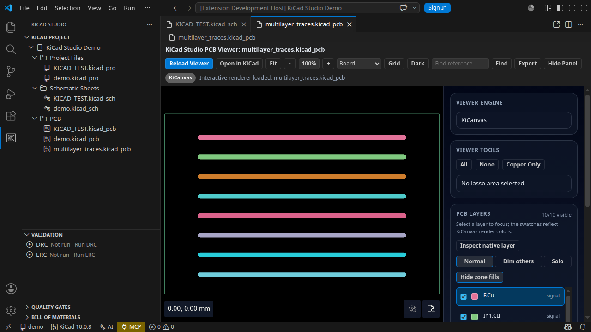
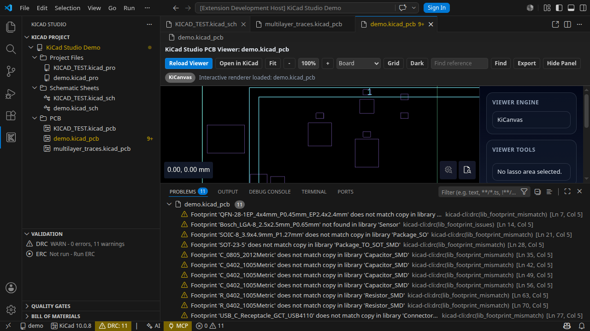
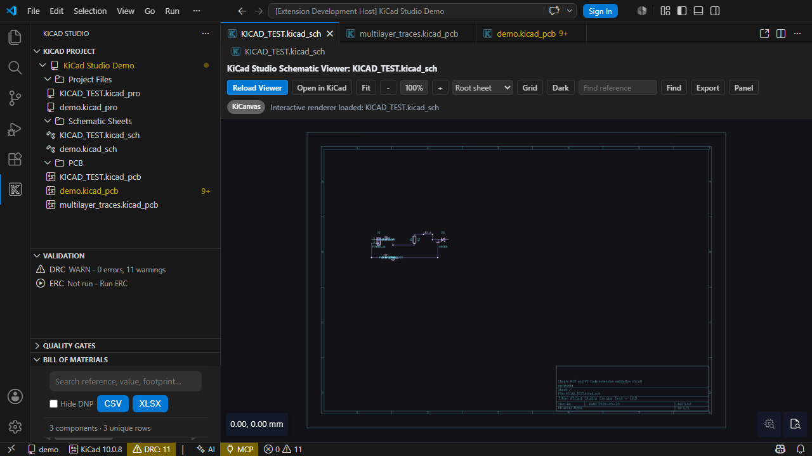
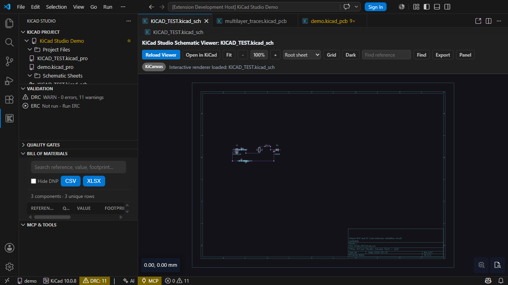

# KiCad Studio Kit

**A focused VS Code workspace for professional KiCad review, validation, manufacturing handoff, and AI-assisted MCP workflows.**

[](https://github.com/oaslananka/kicad-studio-kit/actions/workflows/ci.yml)
[](https://github.com/oaslananka/kicad-studio-kit/actions/workflows/codeql.yml)
[](https://github.com/oaslananka/kicad-studio-kit/actions/workflows/security.yml)
[](https://scorecard.dev/viewer/?uri=github.com/oaslananka/kicad-studio-kit)
**Historical OpenSSF Best Practices Silver (MIT-licensed period)**

[](https://open-vsx.org/extension/oaslananka/kicadstudiokit)
[](https://open-vsx.org/extension/oaslananka/kicadstudiokit)
[](https://marketplace.visualstudio.com/items?itemName=oaslananka.kicadstudiokit)
[](https://github.com/oaslananka/kicad-studio-kit/blob/main/LICENSE)

[](https://github.com/sponsors/oaslananka)
[](https://www.buymeacoffee.com/oaslananka)

Open VSX downloads are cumulative for that registry; Visual Studio Marketplace
live badges are retired upstream, so no unsupported combined total is shown.

KiCad Studio turns VS Code into a KiCad-aware engineering cockpit: project navigation, schematic and PCB inspection, DRC/ERC review, repeatable release outputs, and MCP readiness for AI-assisted workflows.

- Extension ID: `oaslananka.kicadstudiokit`
- Version: `2.5.0`
- Supported KiCad projects: KiCad 8.x, 9.x, and 10.x project, schematic, PCB, DRC, and jobset files
- Supported MCP server: `kicad-mcp-pro >=4.3.0 <5.0.0`
- Canonical repository: https://github.com/oaslananka/kicad-studio-kit/tree/main/apps/vscode-extension

## Quick Start

1. Install **KiCad Studio** from the Visual Studio Marketplace or Open VSX.
2. Open a folder containing a `.kicad_pro`, `.kicad_sch`, or `.kicad_pcb` file.
3. Run **KiCad: Detect kicad-cli** if KiCad is not already available on `PATH`.
4. Open a schematic or PCB file to inspect the design inside VS Code.
5. Run **KiCad: Run DRC** or **KiCad: Run ERC** to populate Problems and validation views.
6. Optional: start `kicad-mcp-pro` and connect your AI client with the generated `.vscode/mcp.json` schema.

After running ERC, expand **Validation → ERC** in the KiCad Studio sidebar
to browse up to 200 findings with verified KiCad source UUIDs. Selecting one
opens the exact file and source character position in a text editor
(VS Code visual columns can differ on tab-indented lines). The **Problems**
panel still opens the default schematic viewer on double-click;
that alone does not imply exact graphical focus. Unverified or stale ERC
locations are never offered as exact source links.

## NVIDIA Build cloud models (optional)

KiCad Studio supports the NVIDIA-hosted [Build API Catalog](https://build.nvidia.com/)
using an API key and a provider-specific model ID. No local GPU, paid API
subscription, custom endpoint, or new MCP server is needed for prototyping.

1. On an NVIDIA Build model page, select **Generate API Key**.
2. In VS Code, run **KiCad: Manage Chat Provider** → **Pick AI provider** →
   **NVIDIA Build (cloud API)**.
3. Use **Set provider API key** to save the key securely in VS Code SecretStorage.
4. Choose **Pick provider model** to select a suggested model or **Custom
   model...** to enter an exact catalog model ID, e.g.
   nvidia/nemotron-3-super-120b-a12b.
5. Run **Test chat provider** and open **KiCad: Open AI Chat**.

The HTTPS endpoint is fixed to
https://integrate.api.nvidia.com/v1/chat/completions. KiCad Studio sends
NVIDIA-compatible Chat Completions requests and never stores the key in
workspace settings or logs. NVIDIA's free developer endpoints are for
prototyping and have account-specific quotas; do not assume free production
inference. Selecting a remote AI provider transmits the prompt and
explicitly attached KiCad context to that provider. See the
[FAQ](../../docs/faq.md#do-i-need-to-set-up-an-api-key-for-ai-features).

## Task-Oriented Workflows

Open **KiCad Studio: Open Task Hub** from the Command Palette or use the task button in the **KiCad Project** view title. Existing command IDs remain available, while the primary workflows are grouped around the engineering outcome you need.

On a **new workspace**, the sidebar starts with four task-oriented areas: **KiCad Project** (navigate and select), **Validation** (DRC/ERC), **Quality Gates** (collapsed until needed), and **Bill of Materials** (collapsed until needed). The other seven specialist views remain installed and are accessible from the sidebar’s **… → Views** menu. Nothing is deleted; task commands are also available through the Task Hub. VS Code remembers each user's previous view placements and visibility, so existing workspaces retain their individual layout preferences.

| Task                | Top-level command                     | Use it for                                                                                 |
| ------------------- | ------------------------------------- | ------------------------------------------------------------------------------------------ |
| Review              | **KiCad Studio: Review Project**      | Inspect project status, schematics, PCBs, variants, and design diffs                       |
| Validate            | **KiCad Studio: Validate Project**    | Run DRC, ERC, quality gates, AI-assisted findings, and board-readiness checks              |
| Fabrication Release | **KiCad Studio: Fabrication Release** | Prepare reviewed Gerbers, drill files, BOMs, jobsets, and release packages                 |
| Automate            | **KiCad Studio: Automate Project**    | Configure MCP, AI chat, design intent, profiles, and fix queues                            |
| Maintain            | **KiCad Studio: Maintain Workspace**  | Manage KiCad CLI detection, settings, libraries, packages, credentials, logs, and feedback |

## Feature Matrix

| Workflow                 | KiCad Studio                                                                                         | Engineering value                                                              |
| ------------------------ | ---------------------------------------------------------------------------------------------------- | ------------------------------------------------------------------------------ |
| Project navigation       | Native VS Code sidebar for KiCad projects, boards, schematics, jobsets, rules, and generated outputs | Keeps hardware and software workspace context together                         |
| Schematic and PCB review | Custom editors with KiCad-aware controls and CLI fallback paths                                      | Inspect design files without losing KiCad as the source of truth               |
| DRC/ERC validation       | Problems integration, freshness state, quality gates, and focused validation views                   | Separates fresh failures from stale reports                                    |
| Manufacturing handoff    | Repeatable BOM, netlist, plot, drill, and jobset-driven export commands                              | Turns review output into reproducible release artifacts                        |
| MCP readiness            | `kicad-mcp-pro` discovery, version gating, tool status, and workspace context                        | Keeps AI-assisted commands safe when the MCP server is missing or incompatible |
| Localization             | Marketplace copy plus extension string infrastructure                                                | English-only UI; additional translation catalogs are prohibited                |

## Screenshots

### Project Tree



### Schematic Viewer

When the interactive KiCanvas renderer is unavailable, the KiCad CLI SVG fallback initially frames the placed schematic symbols and connected wire geometry on supported KiCad 10 files rather than opening on an empty full sheet. **Fit** restores the full page, while zoom buttons and pointer zoom remain available. Manually selected zoom is retained when resizing or splitting the editor; missing or unsafe coordinates retain the original full-page view. The interactive PCB viewer keeps KiCanvas's supported fit-to-screen behavior (the proposed upstream `zoom=objects` API is not yet supported).



### PCB Viewer



### DRC Results



### Bill of Materials

The BOM panel and its CSV/XLSX exports include only placed schematic symbols that are marked for the BOM. DNP (do-not-populate) components remain identifiable separately from symbols excluded from the BOM; a symbol excluded from board placement is not automatically DNP. KiCad remains the authority for final manufacturing exports.



### MCP & Tools



## KiCad CLI-Only Comparison

| Workflow             | KiCad CLI-only                                                     | KiCad Studio                                                               |
| -------------------- | ------------------------------------------------------------------ | -------------------------------------------------------------------------- |
| Open project context | Requires remembering paths, commands, and output locations         | Discovers KiCad project structure inside the active VS Code workspace      |
| Inspect design state | Exports or external KiCad windows are needed for most review loops | Keeps schematic and PCB review next to source changes                      |
| Run DRC/ERC          | Terminal output and report files must be correlated manually       | Problems, validation views, and quality gates show actionable diagnostics  |
| Share AI context     | Scripts must manually expose project files and tool capabilities   | MCP dashboard gates compatible `kicad-mcp-pro` tools and workspace context |

## MCP Compatibility

KiCad Studio 2.5.0 supports `kicad-mcp-pro >=4.3.0 <5.0.0` and was tested against `4.7.0`. This release uses MCP protocol `2026-07-28`.
The breaking protocol change shipped in KiCad Studio 2.0.0. Servers limited to
MCP `2025-11-25` are incompatible with Studio 2.x; users who need the older
protocol can remain on KiCad Studio 1.17.1 until the server is upgraded.
If a connected server falls outside the supported range, MCP-dependent commands
remain disabled while KiCad-only features remain available.

## Marketplace Listing Copy

The manual Marketplace and Open VSX checklist and English short/long listing copy live in [docs/marketplace-listing.md](docs/marketplace-listing.md).

## Release Notes

Release notes for Marketplace and Open VSX users live in [CHANGELOG.md](CHANGELOG.md).

## Local Development

```powershell
corepack enable
corepack pnpm run dev:doctor -- --ci
corepack pnpm install --frozen-lockfile
corepack pnpm --filter kicadstudiokit run marketplace:check
corepack pnpm --filter kicadstudiokit run build
corepack pnpm --filter kicadstudiokit run package
```

## Marketplace Dry Run

```powershell
corepack enable
corepack pnpm install --frozen-lockfile
corepack pnpm --filter kicadstudiokit run marketplace:check
corepack pnpm --filter kicadstudiokit run build
corepack pnpm --filter kicadstudiokit run package
corepack pnpm --filter kicadstudiokit exec vsce ls --tree --no-dependencies
```

## License

Current project-authored source is licensed under the MIT License, including
commercial use under its terms. Previously published PolyForm releases retain
their original licensing terms. See the repository licensing guide:
https://github.com/oaslananka/kicad-studio-kit/blob/main/LICENSING.md

Third-party bundled material keeps its own license; the KiCanvas notice remains
under `media/kicanvas/NOTICE.txt`.

## Support and Sponsorship

Use GitHub Issues for reproducible bugs, feature requests, Marketplace rendering problems, and KiCad compatibility reports. Include the KiCad version, operating system, extension version, and the command or file type that reproduced the issue.

Commercial users who rely on KiCad Studio for release, manufacturing, or AI-assisted review workflows can sponsor continued development through the repository sponsor links and support channels.
